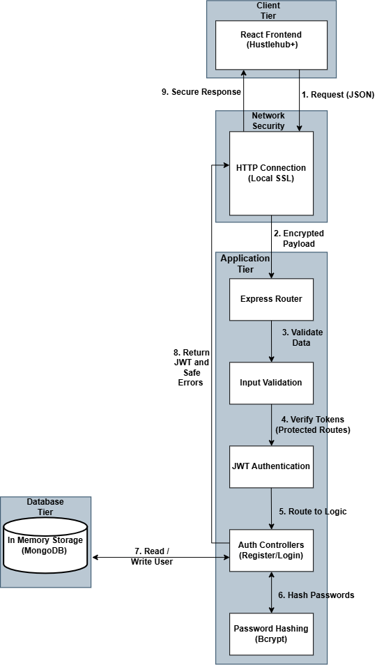

# Hustlehub+

## Demo Video

[HustleHub+ Demo Video](https://www.youtube.com/watch?v=pCq2B8kiXvo)

> **TODO (Sphosethu):** replace with the final Part 3 demonstration video link once it is recorded.

# INSY7314 - Part 3

**Team Members**
- Sphosethu Ximba – ST10448336
- Andiswa Mavundla – ST10440448
- Wandile Simamane – ST10445696
- Mbali Ndlovu – ST10445933

## Tech Stack

| Layer | Technology |
|---|---|
| **Frontend** | React (Vite) + React Router + Tailwind CSS |
| **Charts** | Recharts |
| **Backend API** | Node.js + Express |
| **Database** | MongoDB Atlas / Mongoose |
| **Security** | JSON Web Tokens (JWT), bcrypt, OpenSSL, Express-Rate-Limit |
| **Containerisation** | Docker + Docker Compose |
| **Testing** | Postman / Newman, Vitest |

> **TODO:** Sphosethu, Andiswa and Wandile add your rows here (for example winston and Better Stack, Playwright, GitHub Actions, and the SAST tool).

## Application Features

HustleHub+ is a secure, dual-sided marketplace platform connecting independent service providers (Freelancers) with customers (Clients). 

* **Role-Based Workflows:** Different dashboards and navigation links dynamically rendered based on whether the logged in user is a Client or a Freelancer.
* **Gig Marketplace Feed:** A browsable UI where Clients can discover and search for available services offered by Freelancers.
* **Secure Booking Engine:** Clients can request gigs. The system enforces strict separation, ensuring Freelancers cannot book their own services. 
* **Transaction Lifecycle:** Freelancers can confirm or decline pending gig requests. Confirming a booking automatically generates an immutable financial transaction record in the database.
* **Income Tracking:** An analytics dashboard that calculates confirmed transaction data to display a Freelancer's earned revenue.
* **Tax Estimation:** The Income Dashboard turns confirmed income into an estimated tax liability and net take-home pay, shown with summary cards and charts (see [Tax Estimation](#tax-estimation)).

> **TODO (Wandile):** update the Transaction Lifecycle bullet to describe the mock payment gateway flow (client pays, booking moves to Paid/Escrow, freelancer confirms, income transaction is recorded).

---

## How a Request Flows Through the App

```
Client -> HTTPS/TLS -> Express JSON parser -> Route -> verifyToken(if protected) -> Controller -> Service -> MongoDB -> Response
```

This is a standard Express configuration. The verifyToken middleware checks the JWT before protected routes can be accessed
This is the drawing of the broader MERN architecture:  

 

```
(Client Tier-> HTTPS/TLS network Tier-> Express controller layer -> service layer -> MongoDB data layer.)
```

## Security Decisions

### 1. Password Hashing with bcrypt

Registration (`POST /api/auth/register`) hashes the password with `bcrypt.hash()` using 10 salt rounds before it's ever stored.

#### Why use bcrypt instead of merely SHA-256? 
We use bcrypt to hash passwords before storing them. We did not use SHA-256 because it is designed to be a fast general-purpose hashing algorithm, which is not ideal for storing passwords. bcrypt is slower and uses a salt, meaning that even if two users have the same password, their stored hashes will be different. This makes password cracking more difficult if the password data is ever exposed.

Login (`POST /api/auth/login`) compares passwords using `bcrypt.compare()` rather than manually comparing hashes, since it's built to avoid leaking timing information.

### 2. JWT Authentication

On successful login, the server signs a JWT with `jwt.sign()` using HMAC-SHA256 and a secret from `.env`. The payload is intentionally small:

```json
{
  "id": "64f1c2a9e4b0a1b2c3d4e5f6",
  "role": "Client",
  "iat": 1788524037,
  "exp": 1788527637
}
```

This is enough information to identify the individual and their role. There is no name, email address, or password hash. Tokens expire after 1 hour, so if one gets intercepted, the window an attacker has to use it is limited.

`verifyToken` middleware checks for `Authorization: Bearer <token>`. No header -> `401`. Bad or expired signature → `403`.

### 3. Input Validation & Error Handling

Registration endpoints enforce presence checks for required fields (`name`, `email`, `password`) and reject duplicate email registrations. Controllers wrap logic in `try/catch` blocks, returning generic error messages (e.g., "Internal server error") to avoid leaking stack traces or system file paths to malicious actors.

User ids used in database queries are validated as MongoDB ObjectIds before they reach any query (`toObjectId` in `dashboardService.js`), and `express-mongo-sanitize` strips query operators from incoming requests.

### 4. HTTPS

The server runs over HTTPS using a locally generated self-signed certificate (`server.key` / `server.cert`), created with OpenSSL.

This encrypts everything in transit such as  headers, the JWT and request bodies This is done so it can't be read or tampered with by something sitting on the same network. But it's important to say clearly: **a self-signed cert only works for local development.** Browsers and API clients don't trust it by default for example, Postman needs SSL verification turned off to even talk to it.

In Part 3 the server was changed so it **refuses to start** if the certificate or key is missing. It can no longer fall back to plain HTTP by accident, which is what had happened inside Docker. The frontend calls the API over `https`, and `securityHeaders.js` adds a Content-Security-Policy and HSTS to every response.

### 5. Brute-Force Protection (Rate Limiting)
The `/api/auth/login` route utilizes `express-rate-limit` to restrict users to 5 login attempts per 15-minute window. Exceeding this threshold triggers a `429 Too Many Requests` response, effectively neutralizing automated credential-stuffing attacks.

### 6. Secrets Management
The MongoDB connection string was removed from `server.js`. The backend reads it only from the `MONGODB_URI` environment variable and exits with a clear message if it is missing, so credentials are never stored in source control.

> **TODO (Andiswa):** the full threat-to-protection mapping is in [Final Security Review](#final-security-review-andiswa).

## Project Structure

```text
emkndn-insy7314-2026-insy.../
├── docker-compose.yml          # Orchestrates the backend and frontend containers
├── hustlehub-backend/
│   ├── assets/                 # Architecture diagram and app screenshots
│   ├── postman/                # Exported Postman test collections
│   ├── src/
│   │   ├── controllers/        # auth, booking, dashboard, and gig controllers
│   │   ├── middleware/         # auth, RBAC, rate limiter, and validation middleware
│   │   ├── models/             # booking, gig, transaction, and user Mongoose models
│   │   ├── routes/             # API route definitions
│   │   └── services/           # Business logic (dashboardService, taxService)
│   ├── .env                    # Backend environment variables (gitignored)
│   ├── Dockerfile              # Backend container image
│   ├── server.cert             # Local HTTPS certificate
│   ├── server.key              # Local HTTPS key
│   └── server.js               # Express application entry point
│
├── hustlehub-frontend/
│   ├── public/                 # Public static assets
│   ├── src/
│   │   ├── assets/             # Frontend specific assets
│   │   ├── components/         # React UI components (Dashboard, IncomeDashboard, GigFeed, Auth, etc.)
│   │   ├── api.js              # Frontend API configuration and calls
│   │   ├── App.jsx             # Main React Router configuration
│   │   ├── gigUtils.js         # Frontend utility functions
│   │   ├── index.css           # Global Tailwind and base styles
│   │   └── main.jsx            # React DOM rendering entry point
│   ├── Dockerfile              # Frontend container image
│   ├── eslint.config.js        # Linter configuration
│   ├── index.html              # Vite HTML template
│   ├── package.json            # Frontend dependencies and scripts
│   ├── tailwind.config.js      # Tailwind CSS framework configuration
│   └── vite.config.js          # Vite build tool configuration
```

## API Endpoints

| Method | Endpoint | Access | Description | Status Codes |
|---|---|---|---|---|
| `POST` | `/api/auth/register` | Public | Registers a user, hashes password | `201`, `400`, `500` |
| `POST` | `/api/auth/login` | Public | Verifies credentials, returns JWT | `200`, `400`, `401`, `429`, `500` |
| `GET` | `/api/auth/protected-test` | Protected | Sanity check for JWT middleware | `200`, `401`, `403` |
| `POST` | `/api/bookings` | Client only | Creates a booking (blocked for Freelancers) | `201`, `400`, `403`, `500` |
| `GET` | `/api/bookings` | Protected | Fetches bookings based on user role | `200`, `401`, `500` |
| `PUT` | `/api/bookings/:id` | Freelancer only | Confirms booking, generates transaction | `200`, `400`, `403`, `404`, `500` |
| `GET` | `/api/dashboard/summary` | Freelancer only | Gross income, estimated tax, net take-home and monthly breakdown | `200`, `401`, `403`, `500` |
| `GET` | `/api/dashboard/transactions` | Freelancer only | Payment history for the freelancer | `200`, `401`, `403`, `500` |
| `GET` | `/api/dashboard/bookings` | Freelancer only | Bookings received by the freelancer | `200`, `401`, `403`, `500` |

> **TODO (Wandile):** add the mock payment endpoints. **TODO (Sphosethu):** add the gig unpublish endpoint.

---

## Tax Estimation

HustleHub+ gives each freelancer an estimate of the income tax they may owe, based on their **confirmed** income. The estimate is calculated on the server in `hustlehub-backend/src/services/taxService.js` and returned by the dashboard service.

### What counts as income

A `Transaction` is only created after the freelancer confirms a booking, so every Transaction is confirmed income. Gross income is the sum of the `amount` field across the freelancer's Transactions, calculated in MongoDB with an aggregation pipeline. Amounts are rounded to 2 decimal places.

### How tax is calculated

The estimate uses the South African SARS individual income tax rates for the **2026/27 tax year**
