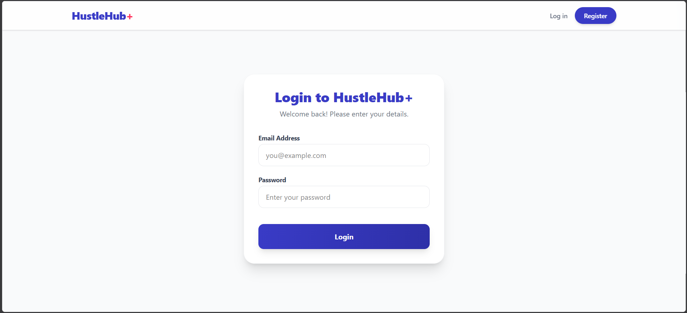
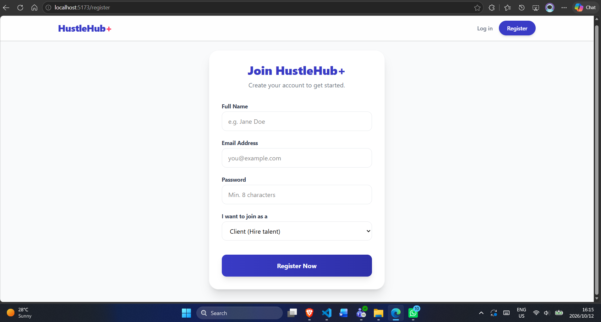
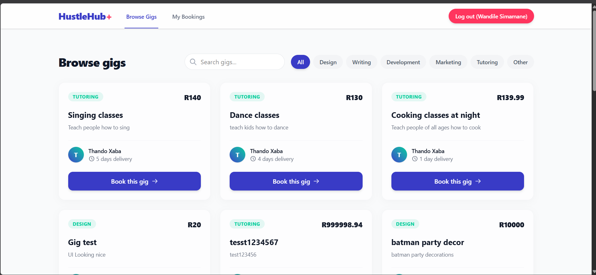
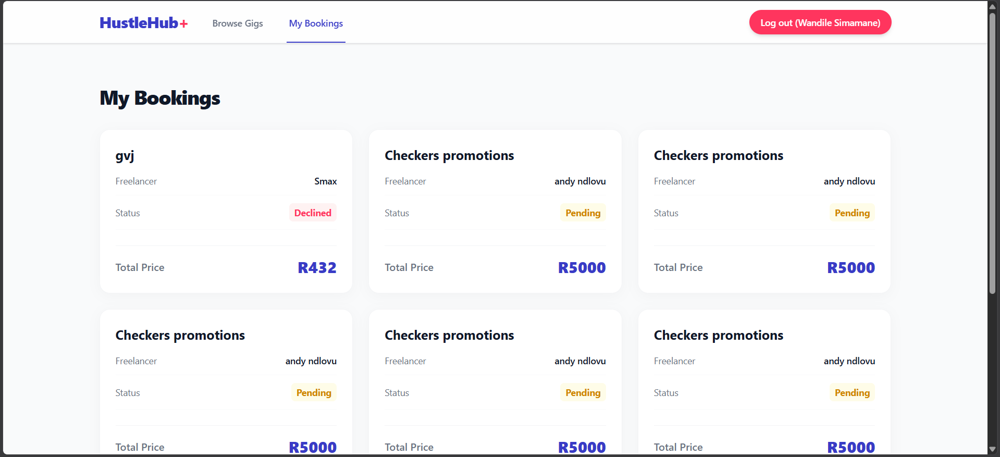
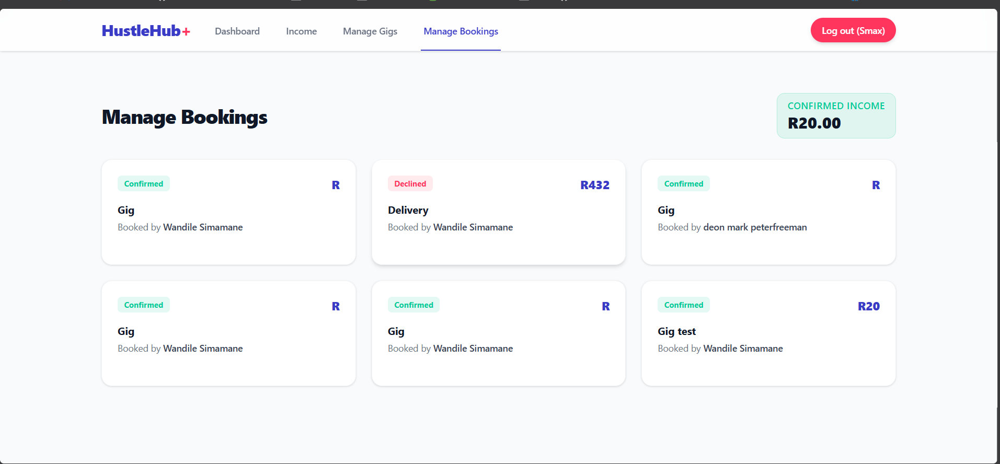
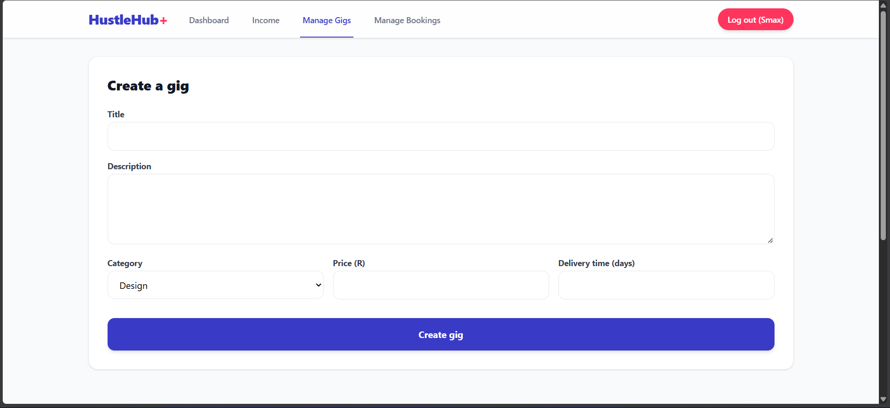
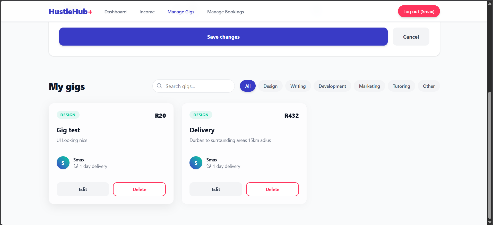
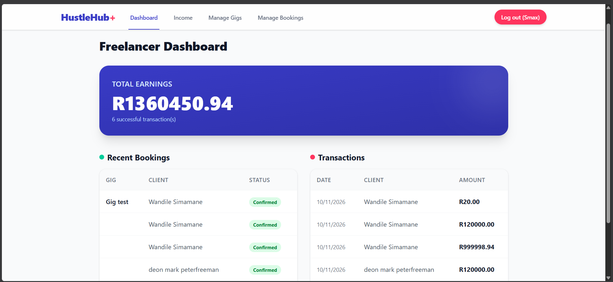
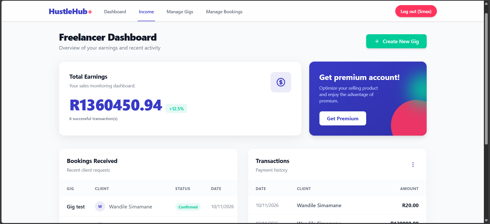

# Hustlehub+

## Demo Video

[HustleHub+ Demo Video](https://www.youtube.com/watch?v=pCq2B8kiXvo)

# INSY7314 - Part 2

**Team Members**
- Sphosethu Ximba – ST10448336
- Andiswa Mavundla – ST10440448
- Wandile Simamane – ST10445696
- Mbali Ndlovu – ST10445933

## Tech Stack

| Layer | Technology |
|---|---|
| **Frontend** | React (Vite) + React Router |
| **Backend API** | Node.js + Express |
| **Database** | MongoDB Atlas / Mongoose |
| **Security** | JSON Web Tokens (JWT), bcrypt, OpenSSL, Express-Rate-Limit |
| **Testing** | Postman / Newman |

## Application Features

HustleHub+ is a secure, dual-sided marketplace platform connecting independent service providers (Freelancers) with customers (Clients). 

* **Role-Based Workflows:** Different dashboards and navigation links dynamically rendered based on whether the logged in user is a Client or a Freelancer.
* **Gig Marketplace Feed:** A browsable UI where Clients can discover and search for available services offered by Freelancers.
* **Secure Booking Engine:** Clients can request gigs. The system enforces strict separation, ensuring Freelancers cannot book their own services. 
* **Transaction Lifecycle:** Freelancers can confirm or decline pending gig requests. Confirming a booking automatically generates an immutable financial transaction record in the database.
* **Income Tracking:** An analytics dashboard that calculates confirmed transaction data to display a Freelancer's earned revenue.

---

## How a Request Flows Through the App

```
Client -> HTTPS/TLS -> Express JSON parser -> Route -> verifyToken(if protected) -> Controller -> In memory store -> Response
```

This is a standard Express configuration. The verifyToken middleware checks the JWT before protected routes can be accessed
This is the drawing of the broader MERN architecture:  

 

```
(Client Tier-> HTTPS/TLS network Tier-> Express controller layer -> abstracted data layer, currently in-memory, MongoDB later.)

```

## Security Decisions

### 1. Password Hashing with bcrypt

Registration (`POST /api/auth/register`) hashes the password with `bcrypt.hash()` using 10 salt rounds before it's ever stored.

#### Why use bcrypt instead of merely SHA-256? 
We use bcrypt to hash passwords before storing them. We did not use SHA-256 because it is designed to be a fast general-purpose hashing algorithm, which is not ideal for storing passwords. bcrypt is slower and uses a salt, meaning that even if two users have the same password, their stored hashes will be different. This makes password cracking more difficult if the password data is ever exposed.

Login (`POST /api/auth/login`) compares passwords using `bcrypt.compare()` rather than manually comparing hashes, since it's built to avoid leaking timing information.

### 2. JWT Authentication

On successful login, the server signs a JWT with `jwt.sign()` using HMAC-SHA256 and a secret from `.env`. The payload is intentionally small:

```json
{
  "id": 1,
 "role": "Client",
  "iat": 1788524037
  "exp": 1788527637
}
```

This is enough information to identify the individual and their role. There is no name, email address, or password hash. Tokens expire after 1 hour, so if one gets intercepted, the window an attacker has to use it is limited.

`verifyToken` middleware checks for `Authorization: Bearer <token>`. No header -> `401`. Bad or expired signature → `403`.

### 3. Input Validation & Error Handling

Registration endpoints enforce presence checks for required fields (`name`, `email`, `password`) and reject duplicate email registrations. Controllers wrap logic in `try/catch` blocks, returning generic error messages (e.g., "Internal server error") to avoid leaking stack traces or system file paths to malicious actors.

### 4. HTTPS

The server runs over HTTPS using a locally generated self-signed certificate (`server.key` / `server.cert`), created with OpenSSL.

This encrypts everything in transit such as  headers, the JWT and request bodies This is done so it can't be read or tampered with by something sitting on the same network. But it's important to say clearly: **a self-signed cert only works for local development.** Browsers and API clients don't trust it by default for example, Postman needs SSL verification turned off to even talk to it.

### 5. Brute-Force Protection (Rate Limiting)
The `/api/auth/login` route utilizes `express-rate-limit` to restrict users to 5 login attempts per 15-minute window. Exceeding this threshold triggers a `429 Too Many Requests` response, effectively neutralizing automated credential-stuffing attacks.


## Project Structure

```text
emkndn-insy7314-2026-insy.../
├── hustlehub-backend/
│   ├── assets/                 # Architecture diagram and app screenshots
│   ├── postman/                # Exported Postman test collections
│   ├── src/
│   │   ├── controllers/        # auth, booking, dashboard, and gig controllers
│   │   ├── middleware/         # auth, RBAC, rate limiter, and validation middleware
│   │   ├── models/             # booking, gig, transaction, and user Mongoose models
│   │   ├── routes/             # API route definitions
│   │   └── services/           # Business logic and service layers
│   ├── .env                    # Backend environment variables (gitignored)
│   ├── server.cert             # Local HTTPS certificate
│   ├── server.key              # Local HTTPS key
│   └── server.js               # Express application entry point
│
├── hustlehub-frontend/
│   ├── public/                 # Public static assets
│   ├── src/
│   │   ├── assets/             # Frontend specific assets
│   │   ├── components/         # React UI components (Dashboard, GigFeed, Auth, etc.) and CSS
│   │   ├── api.js              # Frontend API configuration and calls
│   │   ├── App.jsx             # Main React Router configuration
│   │   ├── gigUtils.js         # Frontend utility functions
│   │   ├── index.css           # Global Tailwind and base styles
│   │   └── main.jsx            # React DOM rendering entry point
│   ├── eslint.config.js        # Linter configuration
│   ├── index.html              # Vite HTML template
│   ├── package.json            # Frontend dependencies and scripts
│   ├── tailwind.config.js      # Tailwind CSS framework configuration
│   └── vite.config.js          # Vite build tool configuration

## API Endpoints

| Method | Endpoint | Access | Description | Status Codes |
|---|---|---|---|---|
| `POST` | `/api/auth/register` | Public | Registers a user, hashes password | `201`, `400`, `500` |
| `POST` | `/api/auth/login` | Public | Verifies credentials, returns JWT | `200`, `400`, `401`, `429`, `500` |
| `GET` | `/api/auth/protected-test` | Protected | Sanity check for JWT middleware | `200`, `401`, `403` |
| `POST` | `/api/bookings` | Client only | Creates a booking (blocked for Freelancers) | `201`, `400`, `403`, `500` |
| `GET` | `/api/bookings` | Protected | Fetches bookings based on user role | `200`, `401`, `500` |
| `PUT` | `/api/bookings/:id` | Freelancer only | Confirms booking, generates transaction | `200`, `400`, `403`, `404`, `500` |

## Setup & Installation

### 1. Backend Setup

Open a terminal and navigate to the backend directory:

```bash
cd hustlehub-backend
npm install
```

**Generate the SSL certificate.** Run this in the root of the backend folder to create the HTTPS keys:

```bash
openssl req -nodes -new -x509 -keyout server.key -out server.cert -days 365 -subj "/CN=localhost"
```

**Configure environment variables.** Create a `.env` file in the `hustlehub-backend` folder:

```env
PORT=5000
JWT_SECRET=super_secret_hustlehub_development_key_2026
MONGODB_URI=mongodb://127.0.0.1:27017/hustlehub
```

**Start the backend server:**

```bash
npm run dev
```

The API will boot securely at `https://localhost:5000`.

### 2. Frontend Setup

Open a new, separate terminal and navigate to the frontend directory:

```bash
cd hustlehub-frontend
npm install
```

**Configure frontend environment.** If your Vite React app requires the API URL to be set explicitly, create a `.env` file in the `hustlehub-frontend` folder:

```env
VITE_API_URL=https://localhost:5000
```

**Start the React development server:**

```bash
npm run dev
```

The frontend will boot at `http://localhost:5173` (or the port specified by Vite).

---

---

## Application Gallery

### User Interface (Frontend)
Here are visual previews of the HustleHub+ application running locally:

**Authentication:**
* **Login Page:** 
* **Register Page:** 

**Client View:**
* **Client Dashboard:** 
* **Client Bookings:** 
* **Manage Bookings:** 
* **Manage Gigs:** 
* **Edit Gigs:** 

**Freelancer View:**
* **Freelancer Dashboard:** 
* **Freelancer Income:** 

## Testing Procedures

The system is validated through a combination of automated API tests and manual end-to-end UI workflows.

### 1. API Testing (Postman / Newman)

The backend routes, security middleware, and database operations are tested using Postman.

- **Collection location:** The exported test suite is located at `hustlehub-backend/postman/Hustlehub.postman_collection.json`.
- **Important requirement:** Because the backend uses local HTTPS, you must turn off SSL verification in Postman (**Settings > General > SSL certificate verification: OFF**).
- **Execution:** Import the collection into Postman and click **Run Collection**. The tests verify:
  - `201 Created` for successful bookings
  - `403 Forbidden` for RBAC violations (e.g., a Freelancer attempting to book a gig)
  - `429 Too Many Requests` when the rate limiter is triggered

### 2. End-to-End UI Testing

To verify the full MERN stack integration, perform the following manual workflow in the browser:

1. Navigate to the React frontend at `http://localhost:5173`.
2. **Authentication:** Register two new accounts, one with the `Client` role and one with the `Freelancer` role.
3. **Gig creation:** Log in as the Freelancer and create a test gig. Log out.
4. **RBAC & booking:** Log in as the Client. Verify that the Gig Feed renders the Freelancer's service. Click the **Book** button to initiate a request.
5. **Transaction verification:** Log back in as the Freelancer. Navigate to the bookings view, confirm the Client's pending request, and check the Income Dashboard/Database to verify the corresponding financial transaction was generated.
## Testing

Endpoints were initially built and verified using Postman. To ensure consistent quality and fulfill Foundation QA requirements, the entire `Hustlehub Part 2.postman_collection.json` suite was executed via the Newman CLI against the local secure server. 

The test suite validates:
*   Successful user registration (`201 Created`) and conflict handling (`409 Conflict`).
*   Successful authentication (`200 OK`) and credential rejection (`401 Unauthorized`).
*   Rate limiting triggers on brute-force login attempts (`429 Too Many Requests`).
*   Role-Based Access Control (RBAC) preventing Clients from accessing Freelancer income dashboards or booking endpoints (`403 Forbidden`).

### Newman Execution Evidence


## References

### AI Declaration

- **Date:** October 11, 2026
- **Description:** Assisted with Tailwind CSS v4 configuration, debugging Vite routing and styling the glassmorphism dashboard layout.
- **Chat Link:** [https://share.gemini.google/E3FLTlhfku18](https://share.gemini.google/E3FLTlhfku18)

### Code References

**Express Rate Limit Configuration**

- **Author:** badamZA
- **Date:** Aug 12, 2026
- **Availability:** [https://github.com/INSY7314-2026-EMDBN/Hello-INSY7314/tree/main/09%20-%20Rate%20Limiting](https://github.com/INSY7314-2026-EMDBN/Hello-INSY7314/tree/main/09%20-%20Rate%20Limiting)
- **Accessed:** October 8, 2026
